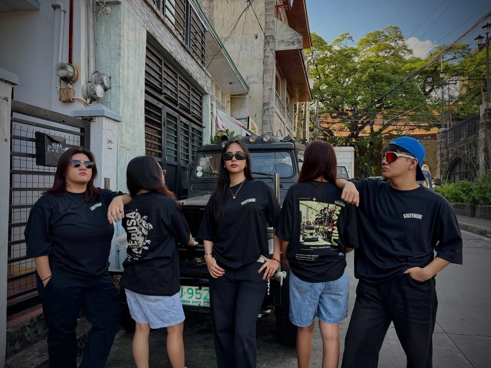

<p align="center">
  
</p>

<h1 align="center">KALYE NOIR</h1>

<p align="center">
  <strong>Classy kalye.</strong> Manila streetwear, cut with a noir edge.<br>
  <em>NASA KALYE NANGANGARAP · MANILA NEVER SLEEPS</em><br>
  EST. 2026 · STREET WEAR • MANILA · 14.5995° N, 120.9842° E
</p>

<p align="center">
  <a href="https://kalyenoir.netlify.app">
    
  </a>
  
  
  
  
</p>

<p align="center">
  
  
  
</p>

---

## 📌 Overview

**Kalye Noir** is an independent Manila-born streetwear label and ecommerce storefront. Designed from the ground up for speed, visual grit, and frictionless customer ordering across the Philippines.

- **Production Storefront**: [kalyenoir.netlify.app](https://kalyenoir.netlify.app)
- **Framework**: Astro 5 (Static Site Generation + Serverless Functions) + Tailwind CSS v4 + Nanostores
- **Fulfillment Pipeline**: Automated Discord Bot alerts with one-click order fulfillment buttons (`Pack`, `Ship`, `Delivered`, `Cancel`) and live webhook dispatch.

---

## 👕 The Collection (Batch 001)

Heavyweight 240 GSM combed cotton tees, tailored with drop-shoulder boxy cuts and high-density silkscreen prints cured for long-term wash durability.

| Design | Tagline | Silhouette | Price |
| :--- | :--- | :--- | :--- |
| **KALYENOIR** | *Nasa Kalye Nangangarap* | Heavyweight Boxy Cut · Black | ₱349.00 |
| **MEDUSA** | *Not Your Myth* | Heavyweight Boxy Cut · Black | ₱349.00 |
| **MANILA** | *Manila Never Sleeps* | Heavyweight Boxy Cut · Black | ₱349.00 |

---

## ⚡ How It Works

1. **Browse & Select**: Interactive PDP with synchronized thumbnail galleries and real-time cursor zoom inspection.
2. **Persistent Cart**: Client-side state managed via `@nanostores/persistent` in `localStorage`.
3. **Checkout & Payment**:
   - Supports **Cash on Delivery (COD)** nationwide and **GCash / Maya** manual transfers with proof-of-payment slip uploads.
   - Intelligent shipping calculator based on Luzon, Visayas, and Mindanao courier tiers (Free delivery on orders of 3+ tees).
4. **Instant Discord Fulfillment**:
   - Every submitted order dispatches to the team's private Discord channel via Netlify Serverless Function (`/api/submit-order`).
   - The team receives a rich `#c8202a` registration-red embed with complete customer info, shipping address, ordered items, totals, and attached receipt slips.
   - Integrated Discord bot provides interactive button controls (`[ 📦 Pack ]`, `[ 🚚 Ship ]`, `[ ✅ Delivered ]`, `[ ❌ Cancel ]`) to track orders without leaving Discord.

---

## 🛠️ Tech Stack & Architecture

```
├── src/                         # Astro Storefront
│   ├── components/              # UI components (Header, Footer, CartDrawer, etc.)
│   ├── pages/                   # Static pages (index, products, checkout, cart, contact)
│   ├── stores/                  # Nanostores reactive state (cartStore.ts)
│   ├── config/                  # Site and worker environment configuration
│   └── styles/                  # Tailwind CSS v4 styling & typography tokens
├── netlify/
│   └── functions/               # Serverless order submission endpoint (/api/submit-order)
├── discord-bot/                 # Node.js Discord Bot daemon & HTTP API server
│   ├── src/                     # Discord.js gateway client, embed builder, slash commands
│   └── data/                    # Local order persistence
├── shared/                      # Code shared across storefront, serverless & worker
│   ├── validation.ts            # Order schema and payload validation
│   ├── shipping.ts              # Philippine province & delivery tier rules
│   └── discord.ts               # Discord embed builder & multi-transport notifier
└── worker/                      # Cloudflare Worker alternative backend
```

---

## 🚀 Local Development

### 1. Clone & Install
```bash
git clone https://github.com/xijun0724-maker/kalye-noir.git
cd kalye-noir
npm install
```

### 2. Environment Setup
Copy the environment template:
```bash
cp .env.example .env
```

Configure your Discord credentials in `.env`:
```env
PUBLIC_DISCORD_WEBHOOK_URL=https://discord.com/api/webhooks/YOUR_WEBHOOK_ID/YOUR_WEBHOOK_TOKEN
PUBLIC_DISCORD_BOT_SERVER_URL=http://localhost:4323/api/order
```

### 3. Run Development Server
```bash
npm run dev
```
Visit `http://localhost:4321` in your browser.

### 4. Optional: Run the Discord Bot
In a separate terminal:
```bash
cd discord-bot
npm install
npm start
```
The bot will connect to Discord as `Kalye Noir Bot` and listen on port `4323` for order events.

---

## 🧪 Testing & Quality Assurance

```bash
# Type-checking and template diagnostics
npm run check

# Storefront unit tests (node --test)
npm test

# Worker tests (vitest)
npm --prefix worker test

# Production build verification
npm run build
```

---

## 📄 License

Proprietary © 2026 Kalye Noir Manila. All rights reserved.
Developed for Kalye Noir Streetwear Studio.
