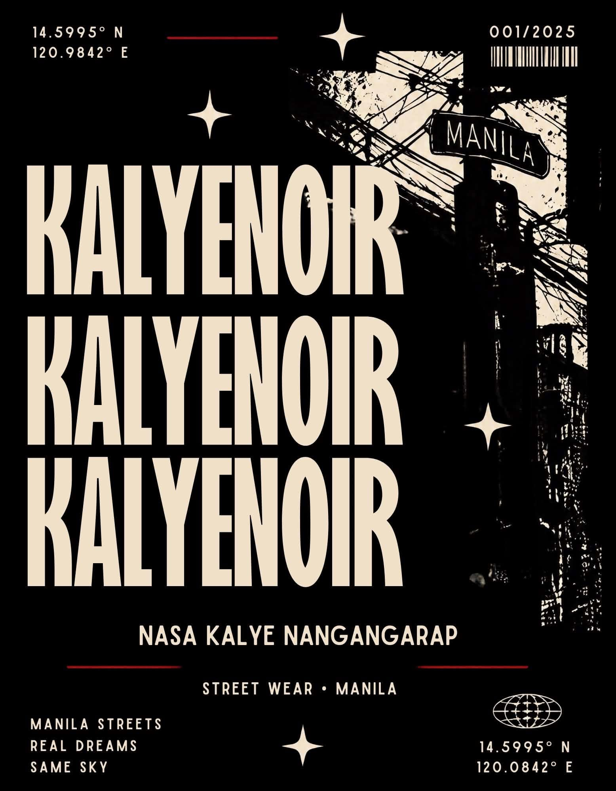
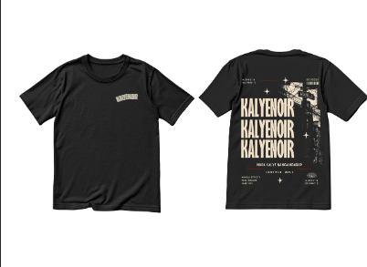
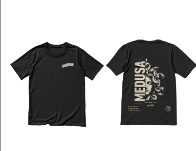

<p align="center">
  
</p>

<h1 align="center">KALYE NOIR</h1>

<p align="center">
  <strong>Classy kalye.</strong> Manila streetwear, cut with a noir edge.<br>
  <em>NASA KALYE NANGANGARAP · MANILA NEVER SLEEPS</em><br>
  EST. 2026 · STREET WEAR • MANILA · 14.5995° N, 120.9842° E
</p>

<p align="center">
  Live site: <a href="https://kalyenoir.netlify.app">kalyenoir.netlify.app</a> &nbsp;·&nbsp; Manila streetwear storefront (Astro + Tailwind + nanostores).
</p>

<p align="center">
  
  
  
</p>

---

**This repo** is the source for the live Kalye Noir storefront at [kalyenoir.netlify.app](https://kalyenoir.netlify.app): a small-batch Manila streetwear shop. It is the real store, not a generic template or theme.

## The label

Kalye Noir takes the street (*kalye*) and renders it with a designer's eye and a noir edge. Small-batch, made in Manila, for late nights and early dreams. Vernacular you can wear: jeepneys and tangled wires, halftone Gorgons, lanterns strung over Divisoria. Local proof over generic streetwear.

## The collection

Three heavyweight tees, black, S–2XL, chest mark with a full back print.

| Design | Story |
| --- | --- |
| **KALYENOIR** | The stacked wordmark over the wreathed Manila wires. *NASA KALYE NANGANGARAP.* |
| **MEDUSA** | The Gorgon stare in halftone. *Not your myth.* |
| **MANILA** | The Divisoria street scene (jeepney, wires, lanterns) under *Manila never sleeps.* |

## How the shop works

Straightforward and message-first:

1. **Browse** the collection and open a piece.
2. **Pick a size** (S–2XL) and **add to cart**.
3. **Review** in the slide-in cart or the full cart page.
4. **Send the request** at checkout: the studio receives the order and an order summary is emailed to you.

Each tee is **₱325**. Delivery is calculated from the selected province, with free delivery on orders of three or more tees. Choose Cash on Delivery or GCash / Maya manual transfer at checkout. The payment QR is unavailable; the checkout shows the merchant account details for manual transfer.

## Running it

Astro static build. The cart lives in `localStorage`; a Netlify Function emails each order to the studio and sends the customer an order summary.

```sh
npm install
npm run dev      # http://localhost:4321
npm run check    # types + template diagnostics
npm test         # unit tests (node --test)
npm run build    # output in dist/
npm run preview  # preview the build
```

Deploys on Netlify via `netlify.toml` (`npm run build` → `dist/`). The checkout function sends the store copy and the customer copy through [Resend](https://resend.com). Set these environment variables in the Netlify site settings (and in a local `.env` when running with the Netlify CLI):

- `RESEND_API_KEY` (required) — your Resend API key. The order function sends only after both emails are accepted by Resend; receipt uploads are optional and limited to 4 MB.
- `RESEND_FROM` (optional) — the verified `From` address, e.g. `"KALYE NOIR" <orders@yourdomain.com>`. Defaults to the Resend sandbox domain `onboarding@resend.dev`.

**To send real order emails your store needs a verified domain in Resend.** Without a verified domain, Resend only lets you send to the account owner's email address and to Resend's test inboxes — it will not deliver the store copy (`kalyenoirorders@gmail.com`) or your customers' emails. To fix that, verify a domain you control in the Resend dashboard (resend.com/domains), then set `RESEND_FROM` to an address at that domain. (The site's `kalyenoir.netlify.app` subdomain is a Netlify shared domain and cannot be verified in Resend — use a domain you own instead.)

`npm run dev` runs the Astro site without Netlify Functions. For end-to-end checkout testing, run the site with the Netlify CLI and provide `RESEND_API_KEY` (and `RESEND_FROM` if you want a non-sandbox sender) through the local environment.

## In this repo

```
src/
  data/catalog.ts                  # the three tees, single source of truth
  data/shipping.ts                 # delivery zones, windows, order terms
  components/AddToCartForm.astro   # size + qty → cart store
  components/CartDrawer.astro      # slide-in cart
  components/ProvinceSelect.astro  # zone picker, shared by cart + checkout
  pages/                           # home, catalogue, product, cart, checkout, contact
  stores/cartStore.ts              # localStorage cart (nanostores)
  lib/zoom.ts                      # PDP hover-zoom geometry
netlify/functions/submit-order.mts # validate checkout and email the store + customer
DESIGN.md                          # the design system
```

All artwork belongs to Kalye Noir.
