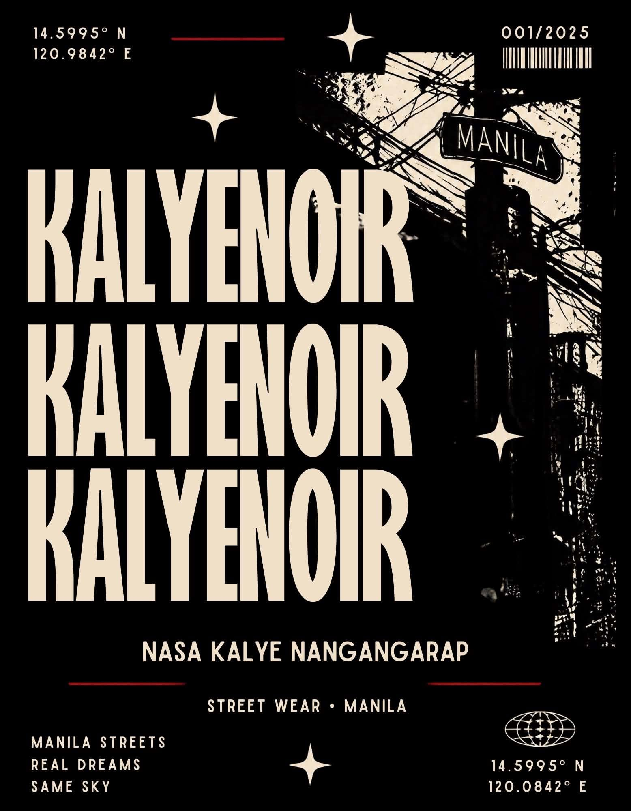
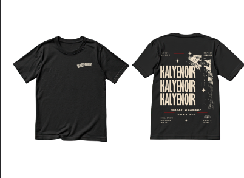

<p align="center">
  
</p>

<h1 align="center">KALYE NOIR</h1>

<p align="center">
  <strong>Classy kalye.</strong> Manila streetwear, cut with a noir edge.<br>
  <em>NASA KALYE NANGANGARAP · MANILA NEVER SLEEPS</em><br>
  EST. 2026 · STREET WEAR • MANILA · 14.5995° N, 120.9842° E
</p>

<p align="center">
  
  
  
</p>

---

## The label

Kalye Noir takes the street (*kalye*) and renders it with a designer's eye and a noir edge. Small-batch, made in Manila, for late nights and early dreams. Vernacular you can wear: jeepneys and tangled wires, halftone Gorgons, lanterns strung over Divisoria. Local proof over generic streetwear.

## The collection

Three heavyweight tees, black, S–2XL, chest mark with a full back print.

| Design | Story |
| --- | --- |
| **KALYENOIR** | The stacked wordmark over the wreathed Manila wires. *NASA KALYE NANGANGARAP.* |
| **MEDUSA** | The Gorgon stare in halftone. *Not your myth.* |
| **MANILA** | The Divisoria street scene (jeepney, wires, lanterns) under *Manila never sleeps.* |

## How the shop works

Straightforward and message-first, the way the label actually sells:

1. **Browse** the collection and open a piece.
2. **Pick a size** (S–2XL) and **add to cart**.
3. **Review** in the slide-in cart or the full cart page.
4. **Send the request** at checkout: cart contents, contact and sizing go through in one form.

**Pricing is confirmed per order.** The site publishes no prices, stock levels or delivery claims: a real person replies with the numbers for your order.

## Running it

Astro, static build. No backend; the cart lives in `localStorage` and orders post through Netlify Forms.

```sh
npm install
npm run dev      # http://localhost:4321
npm run check    # types + template diagnostics
npm test         # unit tests (node --test)
npm run build    # output in dist/
npm run preview  # preview the build
```

Deploys on Netlify via `netlify.toml` (`npm run build` → `dist/`). Connect the repo and it ships on push; checkout submissions appear under **Site → Forms**.

## In this repo

```
src/
  data/catalog.ts                  # the three tees, single source of truth
  data/shipping.ts                 # delivery zones, windows, order terms
  components/AddToCartForm.astro   # size + qty → cart store
  components/CartDrawer.astro      # slide-in cart
  components/ProvinceSelect.astro  # zone picker, shared by cart + checkout
  pages/                           # home, catalogue, product, cart, checkout, contact
  stores/cartStore.ts              # localStorage cart (nanostores)
  lib/zoom.ts                      # PDP hover-zoom geometry
DESIGN.md                          # the design system
```

All artwork belongs to Kalye Noir.
