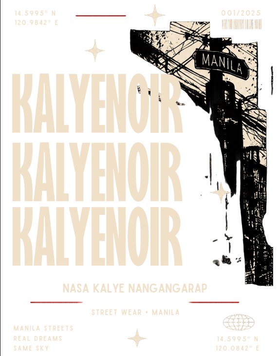
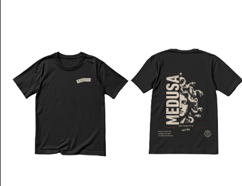
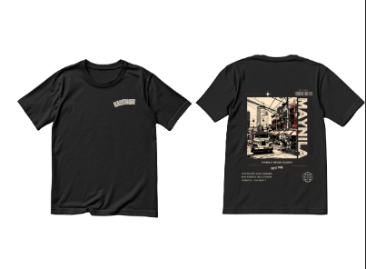
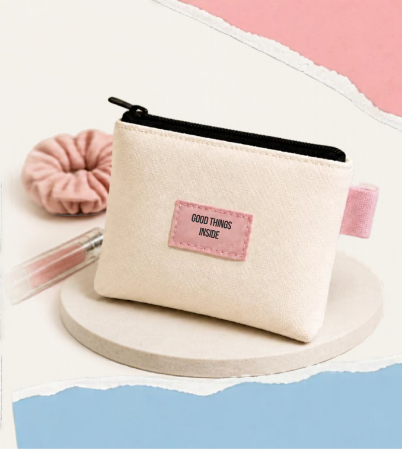
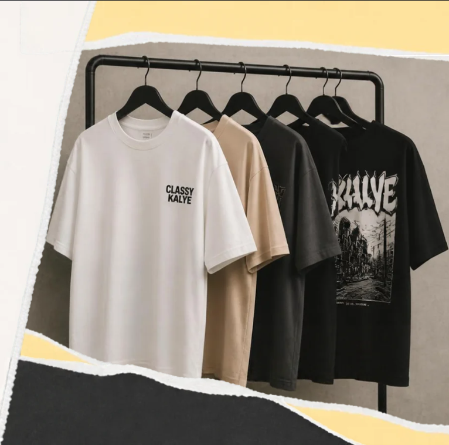
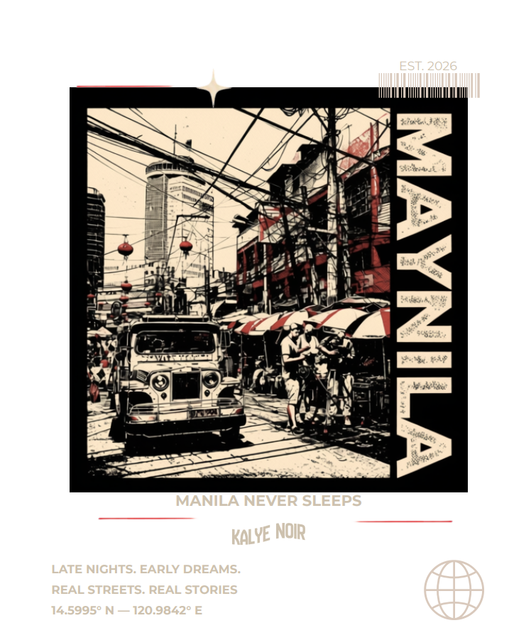

<p align="center">
  
</p>

<h1 align="center">KALYE NOIR</h1>

<p align="center">
  <strong>Classy kalye.</strong> Manila streetwear, cut with a noir edge.<br>
  <em>NASA KALYE NANGANGARAP — MANILA NEVER SLEEPS</em><br>
  EST. 2026 · STREET WEAR • MANILA · 14.5995° N — 120.9842° E
</p>

<p align="center">
  <a href="https://xijun0724-maker.github.io/kalye-noir/"><strong>View the live site →</strong></a>
</p>

<p align="center">
  
  
  
  
</p>

---

## The label

Kalye Noir takes the street — *kalye* — and renders it with a designer's eye and a noir edge. Small-batch, made in Manila, for late nights and early dreams. Vernacular you can wear: jeepneys and tangled wires, halftone Gorgons, lanterns strung over Divisoria. Local proof over generic streetwear.

## The collection

**Oversized Shirts** — heavy graphic tees, front chest mark with a full back print, S–2XL.

| Design | Story |
| --- | --- |
| **MEDUSA** | The Gorgon stare in halftone. *Not your myth.* |
| **MAYNILA** | The Divisoria street scene — jeepney, wires, lanterns — under *Manila never sleeps.* |
| **KALYENOIR** | The stacked wordmark over the wreathed Manila wires. *NASA KALYE NANGANGARAP.* |

**GOOD THINGS INSIDE — Trinket Pouch** — zip pouch with the GOOD THINGS INSIDE label. Pick the colour, patch and cord; made to request.

<p align="center">
  
  
</p>

## How the shop works

Straightforward and message-first, the way the label actually sells:

1. **Browse** the collection on the catalogue page and open a piece.
2. **Pick a size** (S–2XL for shirts; the pouch is made to request) and **add to cart**.
3. **Review** in the slide-in cart or the full cart page.
4. **Send the request** at checkout — cart contents, contact and sizing go through in one form.

**Pricing is confirmed per order.** The site publishes no prices, stock levels or delivery claims — a real person replies with the numbers for your order. Customisation requests (pouch colours, patches, cords) go through the same form.

## Running it

Astro, static build. No backend; the cart lives in `localStorage` and orders post through Netlify Forms.

```sh
npm install
npm run dev      # http://localhost:4321
npm run build    # output in dist/
npm run preview  # preview the build
npm run deploy:pages   # build for the /kalye-noir/ subpath into dist-pages/
```

Deploys on Netlify via `netlify.toml` (`npm run build` → `dist/`). Connect the repo and it ships on push; checkout submissions appear under **Site → Forms**.

The live site runs on **GitHub Pages** from the `gh-pages` branch: [xijun0724-maker.github.io/kalye-noir](https://xijun0724-maker.github.io/kalye-noir/). Pages has no form handling, so there the checkout is display-only — use Netlify for real orders.

## In this repo

```
src/
  data/products.js         # the collection — single source of truth
  pages/
    index.astro            # landing
    products.astro         # catalogue
    products/[slug].astro  # product detail
    cart.astro             # cart + checkout
  layouts/Page.astro       # shell; loads the cart on every page
  scripts/cart.js          # cart state, drawer, checkout sync
public/assets/images/brand/  # the artwork
```

All artwork belongs to Kalye Noir.
