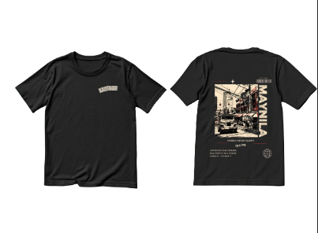

<p align="center">
  
</p>

<h1 align="center">KALYE NOIR</h1>

<p align="center">
  <strong>Classy kalye.</strong> Manila streetwear, cut with a noir edge.<br>
  <em>NASA KALYE NANGANGARAP · MANILA NEVER SLEEPS</em><br>
  EST. 2026 · STREET WEAR • MANILA · 14.5995° N, 120.9842° E
</p>

<p align="center">
  Live site: <a href="https://kalyenoir.netlify.app">kalyenoir.netlify.app</a> &nbsp;·&nbsp; Manila streetwear storefront (Astro + Tailwind + nanostores).
</p>

<p align="center">
  
  
  
</p>

---

**This repo** is the source for the live Kalye Noir storefront at [kalyenoir.netlify.app](https://kalyenoir.netlify.app): a small-batch Manila streetwear shop. It is the real store, not a generic template or theme.

## The label

Kalye Noir takes the street (_kalye_) and renders it with a designer's eye and a noir edge. Small-batch, made in Manila, for late nights and early dreams. Vernacular you can wear: jeepneys and tangled wires, halftone Gorgons, lanterns strung over Divisoria. Local proof over generic streetwear.

## The collection

Three heavyweight tees, black, S–2XL, chest mark with a full back print.

| Design        | Story                                                                              |
| ------------- | ---------------------------------------------------------------------------------- |
| **KALYENOIR** | The stacked wordmark over the wreathed Manila wires. _NASA KALYE NANGANGARAP._     |
| **MEDUSA**    | The Gorgon stare in halftone. _Not your myth._                                     |
| **MANILA**    | The Divisoria street scene (jeepney, wires, lanterns) under _Manila never sleeps._ |

## How the shop works

Straightforward and message-first:

1. **Browse** the collection and open a piece.
2. **Pick a size** (S–2XL) and **add to cart**.
3. **Review** in the slide-in cart or the full cart page.
4. **Send the request** at checkout: the studio receives the order via Telegram and the order details are confirmed on the cart page.

S–L tees are **₱253** and XL–2XL tees are **₱265**. Delivery is calculated from the selected province, with free delivery on orders of three or more tees. Choose Cash on Delivery or GCash / Maya manual transfer at checkout. The payment QR is unavailable; the checkout shows the merchant account details for manual transfer.

## Running it

Astro static build. The cart lives in `localStorage`; a Cloudflare Worker validates the order and sends the order notification via Telegram Bot API.

```sh
npm install
npm run dev      # http://localhost:4321
npm run check    # types + template diagnostics
npm test         # unit tests (node --test)
npm run build    # output in dist/
npm run preview  # preview the build
```

Deploys on Netlify via `netlify.toml` (`npm run build` → `dist/`). The checkout form POSTs to a Cloudflare Worker which validates the order and forwards it to Telegram.

**Required environment variables:**

- `WORKER_SUBMIT_ORDER_URL` — the Cloudflare Worker endpoint (e.g., `https://kalye-noir-orders.<subdomain>.workers.dev/api/submit-order`). Set this in Netlify site settings and in a local `.env` for development.

**Cloudflare Worker secrets (set via `wrangler secret put`):**

- `BOT_TOKEN` — Telegram Bot token from @BotFather
- `CHAT_ID` — Telegram chat ID to receive order notifications

`npm run dev` runs the Astro site. For end-to-end checkout testing, ensure `WORKER_SUBMIT_ORDER_URL` is set in your local `.env` and the Worker is deployed with the required secrets.

## In this repo

```
src/
  data/catalog.ts                  # the three tees, single source of truth
  data/shipping.ts                 # delivery zones, windows, order terms
  components/AddToCartForm.astro   # size + qty → cart store
  components/CartDrawer.astro      # slide-in cart
  components/ProvinceSelect.astro  # zone picker, shared by cart + checkout
  pages/                           # home, catalogue, product, cart (with checkout), contact, incident-report
  stores/cartStore.ts              # localStorage cart (nanostores)
  lib/zoom.ts                      # PDP hover-zoom geometry
  config/worker.ts                 # Worker URL from env
worker/                            # Cloudflare Worker (order validation + Telegram)
  src/index.ts                     # Worker entry: POST /api/submit-order
  src/validation.ts                # Shared validation logic
  src/telegram.ts                  # Telegram Bot API integration
shared/                            # Shared code between frontend + Worker
  validation.ts                    # parseOrderSubmission, formatOrderDetails, types
  shipping.ts                      # shipping zones, fee calculation
  catalog.ts                       # product catalog
DESIGN.md                          # the design system
```

All artwork belongs to Kalye Noir.
